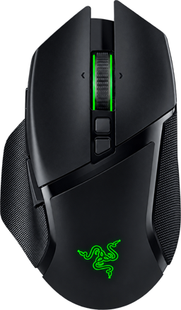

<div align="center">



# Basilisk Pulse

### Your mouse battery. One glance away.

A lightweight desktop tray app for **Razer Basilisk V3 Pro** and **Basilisk V3 Pro 35K** — native Windows builds and a native **Linux preview**.
Battery percentage, an estimate of time remaining to 1%, and a compact interface that stays out of your way.

[](https://github.com/Chill-Man/razer-battery-check/releases)
[](https://github.com/Chill-Man/razer-battery-check/releases)
[](LICENSE)


**[Releases](https://github.com/Chill-Man/razer-battery-check/releases)** · **[Build from source](#build-from-source)** · **[Report an issue](https://github.com/Chill-Man/razer-battery-check/issues)** · **[Русский](docs/README.ru.md)**

</div>

---

## Small app. Useful details.

Keep your battery percentage in the system tray and open the panel with a click. See the last confirmed charge, whether the mouse is charging, and how long it might last before reaching 1%.

Basilisk Pulse reads telemetry directly through Windows HID APIs or Linux hidraw. It does not require a running Razer Synapse interface, an account, a browser engine, or a background web server. Mouse settings stay untouched. Windows uses Win32/Direct2D; Linux uses Qt 5 and shares the same C++ battery model and history logic.

| At a glance | Under the hood |
| :--- | :--- |
| **Battery in the tray** — readable percentage without opening a window. | **Native C++ / Win32** — no Electron, WebView, or .NET runtime dependency. |
| **Time remaining** — starts with a configurable battery-life profile, then learns from discharge history. | **Direct HID telemetry** — battery and charging queries only. |
| **Compact panel** — 320 × 344 logical pixels, rounded surfaces and clear typography. | **Resilient polling** — bounded retries, cached readings, and automatic recovery. |
| **Quiet motion** — soft ambient light and smooth switch transitions. | **Local storage** — no analytics, cloud sync, or network requests. |
| **Optional autostart** — available in Settings. | **Motion on demand** — animation timers stop when the panel is hidden. |

## Downloads

Choose a native build for your operating system and processor. **Portable Windows ZIPs contain a standalone EXE**; Setup installers add a per-user installation and an uninstaller. History/preferences still live in your user profile.

### Windows 10 / 11

| Your PC | Portable ZIP | Setup installer |
| :--- | :---: | :---: |
| Most Intel / AMD PCs — **x64** | [Download](https://github.com/Chill-Man/razer-battery-check/releases/download/v1.5.0/BasiliskPulse-1.5.0-windows-x64-portable.zip) | [Download](https://github.com/Chill-Man/razer-battery-check/releases/download/v1.5.0/BasiliskPulse-1.5.0-windows-x64-setup.exe) |
| 32-bit Windows 10 — **x86 / x32** | [Download](https://github.com/Chill-Man/razer-battery-check/releases/download/v1.5.0/BasiliskPulse-1.5.0-windows-x86-portable.zip) | [Download](https://github.com/Chill-Man/razer-battery-check/releases/download/v1.5.0/BasiliskPulse-1.5.0-windows-x86-setup.exe) |
| Snapdragon / Windows on Arm — **ARM64** | [Download](https://github.com/Chill-Man/razer-battery-check/releases/download/v1.5.0/BasiliskPulse-1.5.0-windows-arm64-portable.zip) | [Download](https://github.com/Chill-Man/razer-battery-check/releases/download/v1.5.0/BasiliskPulse-1.5.0-windows-arm64-setup.exe) |

The ARM64 package contains a native ARM64 application; the Setup launcher itself uses x86 emulation. Windows 11 has no 32-bit x86 edition. Use the architecture in **Settings → System → About → System type**. Minimum Windows version: Windows 10 1607.

### Linux preview

| Processor | AppImage · bundled Qt | DEB · system Qt | Archive · system Qt |
| :--- | :---: | :---: | :---: |
| Intel / AMD **x86_64** · Ubuntu 22.04+ baseline | [Download](https://github.com/Chill-Man/razer-battery-check/releases/download/v1.5.0/BasiliskPulse-1.5.0-linux-x86_64.AppImage) | [Download](https://github.com/Chill-Man/razer-battery-check/releases/download/v1.5.0/BasiliskPulse-1.5.0-linux-x86_64.deb) | [Download](https://github.com/Chill-Man/razer-battery-check/releases/download/v1.5.0/BasiliskPulse-1.5.0-linux-x86_64.tar.gz) |
| **aarch64 / ARM64** · Ubuntu 24.04+ baseline | [Download](https://github.com/Chill-Man/razer-battery-check/releases/download/v1.5.0/BasiliskPulse-1.5.0-linux-aarch64.AppImage) | [Download](https://github.com/Chill-Man/razer-battery-check/releases/download/v1.5.0/BasiliskPulse-1.5.0-linux-aarch64.deb) | [Download](https://github.com/Chill-Man/razer-battery-check/releases/download/v1.5.0/BasiliskPulse-1.5.0-linux-aarch64.tar.gz) |

**[Linux setup, device permissions and desktop support →](docs/LINUX.md)**

Linux is a native port, not a Wine package. Native regression tests and GUI rendering are checked in CI, but physical Linux HID telemetry is not yet hardware-verified. Tray support depends on your desktop; GNOME may need an AppIndicator-compatible extension. AppImage users also need the included udev rule for USB access. No macOS or 32-bit Linux build is currently provided.

**Integrity:** compare your download with [SHA256SUMS.txt](https://github.com/Chill-Man/razer-battery-check/releases/download/v1.5.0/SHA256SUMS.txt). The full package list is on the [release page](https://github.com/Chill-Man/razer-battery-check/releases/tag/v1.5.0).

## Get started

### Portable

Download the matching Windows portable ZIP above, extract it, then run `BasiliskPulse.exe` from a folder you intend to keep. There are no extra runtime installers. For Linux, follow the [Linux guide](docs/LINUX.md).

1. Connect your supported mouse through its HyperSpeed receiver or USB cable.
2. Launch the app. Check the **hidden tray icons** near the Windows clock if the percentage is not immediately visible.
3. Left-click or right-click the percentage to open the panel.

Click outside the panel or press **Esc** to hide it. Choose **Exit** to stop the application.

### Install for your Windows account

After building the app, run this from the project folder:

```powershell
.\install.ps1
```

The installer copies the executable to `%LOCALAPPDATA%\Programs\BasiliskPulse` and creates a **Basilisk Pulse** shortcut in the Start menu. Administrator privileges are not required. Enable **Start with Windows** in the app if desired.

To remove the installed copy:

```powershell
.\uninstall.ps1
```

Uninstallation removes the application, shortcut, and autostart entry. Your measurement history and preferences are retained.

## Supported mice

| Model | USB cable | HyperSpeed receiver | Initial battery-life profile |
| :--- | :---: | :---: | :---: |
| Basilisk V3 Pro | `1532:00AA` | `1532:00AB` | 110 hours |
| Basilisk V3 Pro 35K | `1532:00CC` | `1532:00CD` | 140 hours |
| Basilisk V3 Pro 35K Phantom Green | `1532:00D6` | `1532:00D7` | 140 hours |

**Hardware verification:** direct telemetry has been tested on the original Basilisk V3 Pro receiver (`1532:00AB`). The 35K variants are implemented using documented community protocol identifiers and have not yet been verified on physical 35K hardware in this project.

Bluetooth and separate Mouse Dock Pro / HyperPolling receiver PIDs are not currently supported. The wired **Basilisk V3 35K without “Pro”** is a different device and has no battery to monitor.

## How the estimate works

The displayed runtime is an **estimate**, not a countdown or a guarantee of when the mouse will turn off.

**Before enough history exists**, the app uses:

```text
remaining hours = max(battery percentage − 1, 0) × full-charge profile / 100
```

The initial profiles use manufacturer battery-life figures. RGB lighting, polling rate, battery age, firmware and your usage can change the result. Adjust the full-charge profile to match your experience.

**After a useful discharge segment is recorded**, the app fits a linear regression to the measurements. It needs at least 30 minutes, four samples, and a drop of at least 8 out of 255 raw battery units — approximately 3%.

Charging, a rise in battery level, or a measurement gap longer than 10 minutes starts a new segment. The estimate includes the time between readings, including short idle periods. Histories and custom profiles are kept separate for the original Pro and the 35K family.

| Profile | Original Pro | Pro 35K |
| :--- | :---: | :---: |
| Standard HyperSpeed reference | 110 h | 140 h |
| 8000 Hz reference | 32 h | 28 h |
| Intermediate custom preset | 60 h | 60 h |

These reference values are not measurements of your current configuration. See the official [V3 Pro specifications](https://mysupport.razer.com/app/answers/detail/a_id/6219) and [V3 Pro 35K specifications](https://www.razer.com/gaming-mice/razer-basilisk-v3-pro-35k).

## A sleeping mouse should not erase its battery

Brief HID failures keep the last confirmed percentage and estimate visible. Failed requests are retried after **2, 5, 15, 30, and 60 seconds**, then fall back to your configured polling interval.

During recovery, new mouse or keyboard activity can trigger another attempt within five seconds. Opening the panel, device changes, and resuming Windows also request a refresh.

If fresh readings remain unavailable, the panel marks the value as **last known**. Hover over the tray icon for the age of that reading. The cached value survives an app restart; it is never presented as a newly confirmed hardware response.

## Designed to stay lightweight

- Normal polling: **every 2 minutes**. Economy mode: **every 5 minutes**.
- No raw-input hooks, browser processes, or permanent rendering loop in the tray.
- Ambient animation redraws only the region around the mouse, up to 30 frames per second while the main panel is visible.
- Toggle transitions last **240 ms**, ease smoothly to their target, and reverse from their current position if clicked again.
- Animation timers stop when hidden or when they finish. Windows reduced-motion settings are respected.
- Graphics resources and font caches are released when the panel closes.
- A low-battery notification appears at 15%, once per discharge cycle.

## Local data and privacy

**The application does not send network requests.** All measurements stay on your PC.

| Location | Contents |
| :--- | :--- |
| `%LOCALAPPDATA%\BasiliskPulse\history.tsv` | Original Pro discharge history. |
| `%LOCALAPPDATA%\BasiliskPulse\history-35k.tsv` | 35K discharge history. |
| `%LOCALAPPDATA%\BasiliskPulse\last-reading.tsv` | Last confirmed reading, saved atomically. |
| `%LOCALAPPDATA%\BasiliskPulse\status.json` | Current diagnostic snapshot and retry state. |
| `HKCU\Software\BasiliskPulse` | App preferences and per-model profiles. |

History is bounded to **30 days / 15,000 samples per model**. Cached and failed readings are excluded from discharge training.

## Build from source

Windows builds require **Visual Studio Build Tools with Desktop development with C++**, the target's MSVC C++ libraries/compiler, and a **Windows 10/11 SDK**. No third-party C++ runtime dependencies are required for Windows. Linux requires Qt 5 development libraries; see the [Linux source build](docs/LINUX.md#diagnostics-and-source-build).

```powershell
git clone https://github.com/Chill-Man/razer-battery-check.git
cd razer-battery-check
.\build.ps1
# Or select a target explicitly:
.\build.ps1 -Architecture x86
.\build.ps1 -Architecture arm64
```

The script builds the executable with a static C runtime and runs the regression tests.

```text
dist\x64\BasiliskPulse.exe       Native x64 build (also copied to dist\BasiliskPulse.exe)
dist\x86\BasiliskPulse.exe       Native x86 build
dist\arm64\BasiliskPulse.exe     Native ARM64 build
build\<architecture>\tests.exe  Architecture-specific regression tests
```

Useful commands:

```powershell
# Print HID interfaces and try a real battery query
.\build\tests.exe --probe

# Open an inspection panel that stays visible after losing focus
.\dist\BasiliskPulse.exe --inspect

# Show guides for charge-number / mouse-image alignment
.\dist\BasiliskPulse.exe --inspect --alignment-guides
```

Tests cover discharge regression, quantized readings, charging, gaps, level increases, the 1% threshold, HID reply validation, supported device IDs, model isolation, transient failures, recovery, persistent cache restoration, corrupted data, and a valid 0% reading.

## Troubleshooting

**Cannot find the app?** Check the hidden tray icons next to the clock. Windows decides where new notification icons appear.

**The value is marked last known?** Move the physical mouse to wake it, check the receiver, and use **Refresh**. The app retries automatically. A cached percentage is kept visible while waiting.

**The runtime seems optimistic?** Reduce the full-charge profile in Settings and let the app collect a continuous discharge segment. High polling rates and RGB can reduce battery life substantially.

**A supported 35K does not respond?** Open an [issue](https://github.com/Chill-Man/razer-battery-check/issues) with the Windows version, mouse variant, connection type, firmware version if known, and the relevant `--probe` output. Remove device serial numbers or other personal information before sharing logs.

## Downloads badge

The badge at the top uses GitHub's **release asset download counts** and updates automatically. It does not count clones, repository ZIP downloads, or unique users. Until release assets are published, a download total may be unavailable.

## Release builds

The [release workflow](.github/workflows/release.yml) builds and tests Windows x86/x64/ARM64 and Linux x86_64/aarch64 on native runners. It verifies PE targets, executable startup, silent Windows installation/uninstallation, Linux rendering and AppImage startup, then creates a draft release with checksums. Windows installer builds require Inno Setup 6.3 or newer.

## Credits and license

Created by **[Chill-Man](https://github.com/Chill-Man)**. Software is released under the **[MIT License](LICENSE)**.

Protocol references: [OpenRazer command definitions](https://github.com/openrazer/openrazer/blob/master/driver/razerchromacommon.c) and [device identifiers](https://github.com/openrazer/openrazer/blob/master/driver/razermouse_driver.h). The Windows implementation in this repository was written independently.

Razer product imagery and trademarks belong to their respective owners and are not relicensed under MIT. This is an independent community project, not an official Razer product.
